<picture>
  <source media="(prefers-color-scheme: dark)" srcset="assets/header-dark.svg">
  
</picture>

 

I'm a product manager at [Virtusize](https://www.virtusize.com), where I run the Shopify app end to end: roadmap, pricing and billing, merchant onboarding, and the conversion numbers that come with it. Before that, product at Japan Venture Academy, an internship at Mitsubishi Fuso, and mechanical engineering at Waseda.

Outside work I build the tools I wanted and couldn't find. Mostly macOS and the browser, mostly local-first, and no account if I can help it.

 

### Made

**[Plotted](https://github.com/addobari/ReminderHeatmap)** &ensp; Your completed Apple Reminders as a contribution heatmap, with streaks, habit trackers and a weekly review. Desktop widgets and Shortcuts; nothing leaves your Mac. 
MACOS &ensp;·&ensp; SWIFT &ensp;·&ensp; OPEN SOURCE

**[Simmer](https://simmer.addobari.com)** &ensp; A Chrome extension that remembers what your tabs were for. It turns the pile into a short list of what you're in the middle of, and brings a whole task back in one click. 
CHROME &ensp;·&ensp; FREE &ensp;·&ensp; NO ACCOUNT

**[ClaudeSwitch](https://github.com/addobari/claudeswitch-releases)** &ensp; A menu-bar switcher for anyone juggling more than one Claude Desktop account. 
MACOS &ensp;·&ensp; MENU BAR

 

### Writing

**[Be Present](https://addobari.substack.com)** &ensp; Essays on AI, tech, and work, written for people paying attention.

 

### Elsewhere

[addobari.com](https://addobari.com) &ensp;·&ensp; [LinkedIn](https://www.linkedin.com/in/addobari) &ensp;·&ensp; [X](https://x.com/addobari)
