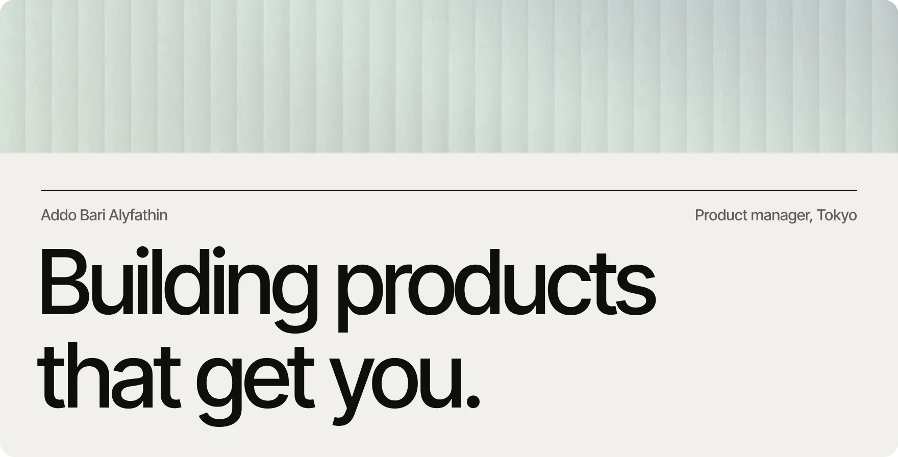
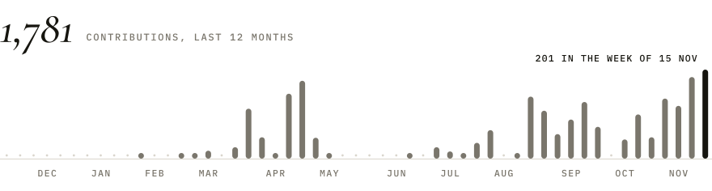

<picture>
  <source media="(prefers-reduced-motion: reduce) and (prefers-color-scheme: dark)" srcset="https://raw.githubusercontent.com/addobari/addobari/output/header-dark-still.png">
  <source media="(prefers-reduced-motion: reduce)" srcset="https://raw.githubusercontent.com/addobari/addobari/output/header-light-still.png">
  <source media="(prefers-color-scheme: dark)" srcset="https://raw.githubusercontent.com/addobari/addobari/output/header-dark.webp">
  
</picture>

 

I'm a product manager at [Virtusize](https://www.virtusize.com), where I run the Shopify app end to end: roadmap, pricing and billing, merchant onboarding, and the conversion numbers that come with it. Before that, product at Japan Venture Academy, an internship at Mitsubishi Fuso, and mechanical engineering at Waseda.

Outside work I build the tools I wanted and couldn't find. Mostly macOS and the browser, mostly local-first, and no account if I can help it.

 

### Made

**[Plotted](https://github.com/addobari/ReminderHeatmap)** &ensp; Your completed Apple Reminders as a contribution heatmap, with streaks, habit trackers and a weekly review. Desktop widgets and Shortcuts; nothing leaves your Mac. 
MACOS &ensp;·&ensp; SWIFT &ensp;·&ensp; OPEN SOURCE

**[Simmer](https://simmer.addobari.com)** &ensp; A Chrome extension that remembers what your tabs were for. It turns the pile into a short list of what you're in the middle of, and brings a whole task back in one click. 
CHROME &ensp;·&ensp; FREE &ensp;·&ensp; NO ACCOUNT

**[ClaudeSwitch](https://github.com/addobari/claudeswitch-releases)** &ensp; A menu-bar switcher for anyone juggling more than one Claude Desktop account. 
MACOS &ensp;·&ensp; MENU BAR

 

<picture>
  <source media="(prefers-color-scheme: dark)" srcset="assets/activity-dark.svg">
  
</picture>

 

### Writing

<!-- WRITING:START -->
**[You don't set the split](https://addobari.substack.com/p/you-dont-set-the-split)** 
26 SEP 2026

**[Whoever funds the boom claims the surplus](https://addobari.substack.com/p/whoever-funds-the-boom-claims-the)** 
23 SEP 2026

**[The unemployment rate can look fine and still be a bad deal](https://addobari.substack.com/p/the-unemployment-rate-can-look-fine)** 
21 SEP 2026

[ALL ESSAYS ON BE PRESENT &ensp;→](https://addobari.substack.com)
<!-- WRITING:END -->

 

### Elsewhere

[addobari.com](https://addobari.com) &ensp;·&ensp; [LinkedIn](https://www.linkedin.com/in/addobari) &ensp;·&ensp; [X](https://x.com/addobari)

 

The header band is rendered each morning from the same WebGL shaders as addobari.com, so it is never the same twice. The chart and Writing refresh daily too. [How it works](scripts/).
